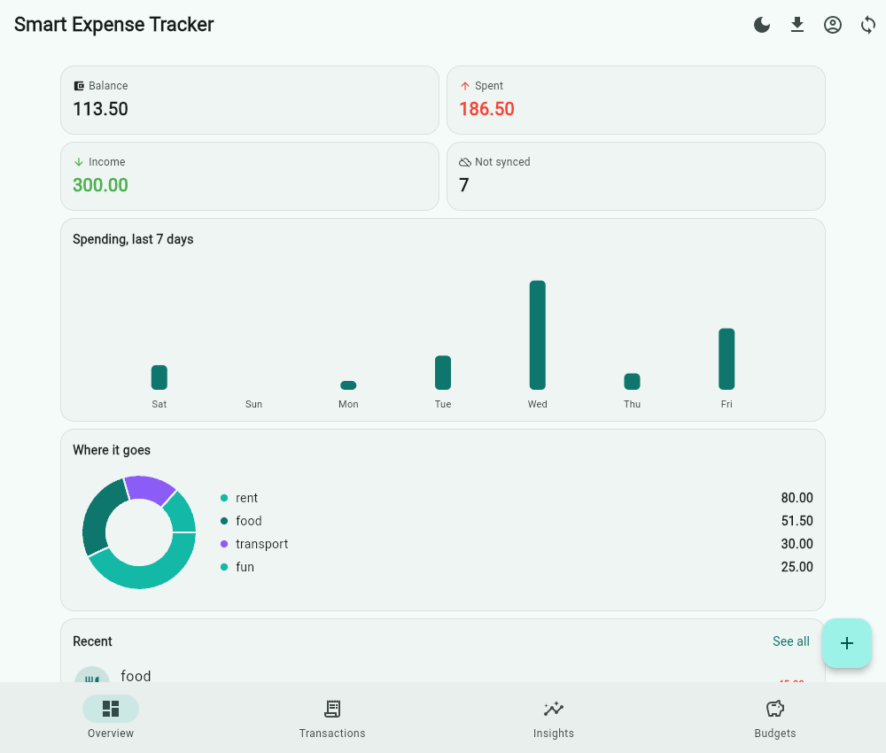
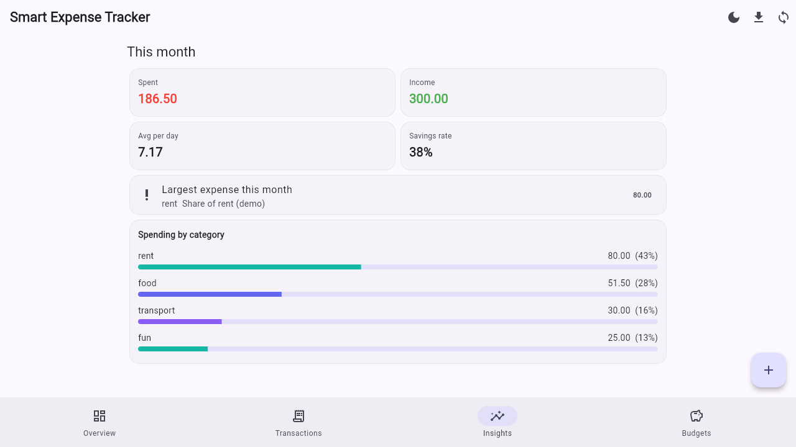
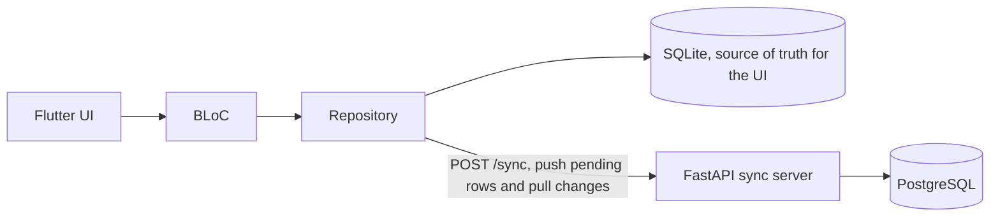

# Smart Expense Tracker (Flutter)

[](https://github.com/ZeyadMohamed00/flutter-smart-expense-tracker/actions/workflows/ci.yml)

Offline-first expense tracker: add income and expenses with no connection, see totals and a category chart, export CSV, and sync to a server when online.

**Live web demo:** https://expense-web-three.vercel.app (sync API: https://expense-api-gamma.vercel.app/docs)
Press "Try demo" to load synthetic entries (every note says "demo"). Press the sync icon to send them to the server. Each browser gets its own random user id.




Four tabs: Overview (7-day chart, category donut), Transactions (search, filters, edit, swipe to delete with undo), Insights (monthly stats), Budgets (per-category monthly limits stored on the device). Dark mode toggle. The web build is deployed from `flutter build web --release --dart-define=API_URL=...`.

## System overview


**Tech stack:** Flutter, Dart, BLoC, SQLite, fl_chart, FastAPI, PostgreSQL, Pytest, Docker.

## Stack
Flutter 3.50 / Dart, BLoC (`flutter_bloc`), SQLite (`sqflite`; WebAssembly SQLite on the web build), `fl_chart`, FastAPI + PostgreSQL sync server.

## Status, honestly
- Verified: `flutter analyze` (no errors), 11 Flutter tests (unit, BLoC, widget) against **real SQLite** (FFI), 4 server tests on real Postgres, and a real-browser click-through of the live web build (Try demo, totals, chart, sync of 7 entries to the live server).
- **Not verified: the Android build.** There is no Android SDK in the build environment, so I never built or ran an APK. The Android code path uses `sqflite` and is the same Dart code, but it has not been run on a device.
- The Flutter sync tests use a mocked HTTP client; the server's sync logic is tested separately in pytest, and the live web demo exercised both together once. There is no automated end-to-end test.
- CSV export copies the CSV to the clipboard (no file picker or share sheet).
- Accounts: optional. Log in or create an account from the account icon (JWT, stored in the server's Postgres) and your entries sync to that account on any device; without one the app works as an anonymous device and keeps everything local. Covered by `app/test/auth_test.dart` (mock server) and the server tests; not tried against a real Android device.
- Docker files are written but were not built here. GitHub Actions CI runs on every push (`.github/workflows/ci.yml`; see the badge for the current state).

## Run
```
cd server && pip install -r requirements.txt && uvicorn exp.main:app   # needs DATABASE_URL (Postgres)
cd app && flutter pub get && flutter run --dart-define=API_URL=http://10.0.2.2:8000
cd app && flutter test && cd ../server && pytest -q
cd app && flutter build web --dart-define=API_URL=https://your-api
```

## How it works / key decisions
- **Local first.** Every write goes to SQLite with `synced = 0`. The UI reads only from SQLite, so offline and online behave the same.
- **Sync is one round trip** (`POST /sync`): push pending rows, get back everything with a server sequence number above your cursor. Conflicts are **last write wins** on `updated_at`. Simple, but a device with a wrong clock can win unfairly.
- **Deletes are soft** (`deleted = 1`) so a deletion can sync to other devices.
- **Race handling.** A row is marked synced only if it has not changed since it was sent, so an edit made during a sync is not lost (tested).
- **Money is integer cents.**
- **Server cursor is a Postgres sequence, not a timestamp,** so clock skew cannot make a device miss rows.
- A real bug found only in the browser: `Random().nextInt(1 << 32)` throws on Dart web (`1 << 32` is 0 in JavaScript), which silently broke adding entries. Fixed to `1 << 30`.

## 5 things to understand
1. Why the UI reads only from SQLite and sync is a background concern.
2. What `synced` and `updated_at` do, and how last write wins decides conflicts.
3. Why deletes are soft.
4. How BLoC events turn into states (`ExpenseBloc`), and why `ExpenseState` derives totals.
5. What is not proven: Android runtime, real auth, and end-to-end tests.

## Accounts (server side)
The sync server now has real accounts: `POST /auth/register`, `POST /auth/login`, `GET /auth/me` (PBKDF2-SHA256 + JWT, users stored in PostgreSQL). Login is throttled per email: 5 failures in 5 minutes returns `429` (in-process memory, so each server instance counts separately). `APP_ENV=production` refuses to start without `JWT_SECRET`; otherwise a demo-only key derived from `DATABASE_URL` is used. `/sync` accepts `Authorization: Bearer <token>` and keeps data under `user:<id>`, so one account syncs across devices; without a token it still uses the anonymous device id. Covered by pytest on real Postgres. **Not done yet:** the Flutter login/register screen (the app still syncs with its anonymous device id until it is added).
